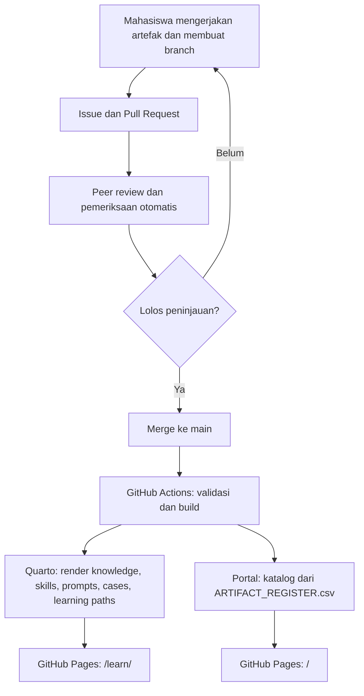

# Arsitektur Satu Repositori KIPP

## Prinsip

- Satu repo sumber; website adalah **hasil build**, bukan proyek dengan konten yang diperbarui manual.
- `ARTIFACT_REGISTER.csv` menentukan 42 entri katalog dan tautan artefak.
- `.qmd` di `topics/` ditampilkan sebagai HTML melalui Quarto di `/learn/`.
- Dokumen `.md` tertentu disalin ke `/repository/` sebagai referensi unduhan saat build.
- Diskusi terjadi di GitHub Discussions; keputusan perubahan melalui Issues/PR.
- Proses build hanya memeriksa struktur teknis. Verifikasi substansi tetap dilakukan mahasiswa dan dosen.

## Daftar verifikasi peluncuran

- [ ] Project Charter disepakati
- [ ] Repositori GitHub dibuat
- [ ] GitHub Pages disetel ke GitHub Actions
- [ ] Discussions diaktifkan
- [ ] Aturan PR dan reviewer lintas tim disetujui
- [ ] Semua 12 tim memiliki akses dan penanggung jawab
- [ ] Lisensi karya disepakati
- [ ] Workflow CI lulus
- [ ] Website publik dapat membuka beranda serta satu artefak Quarto
- [ ] Satu perubahan artefak diuji melalui Pull Request hingga muncul di website
